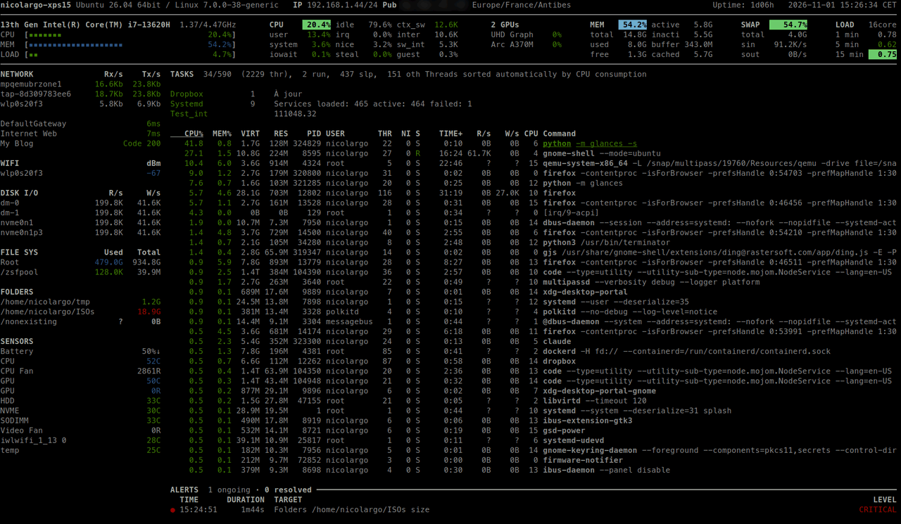
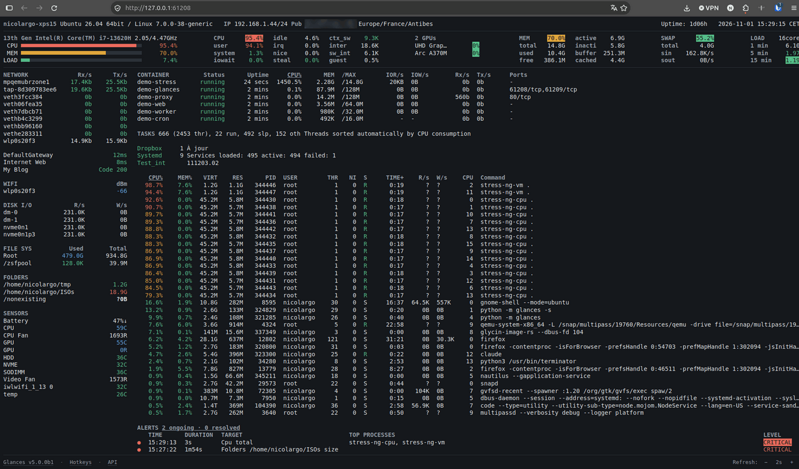
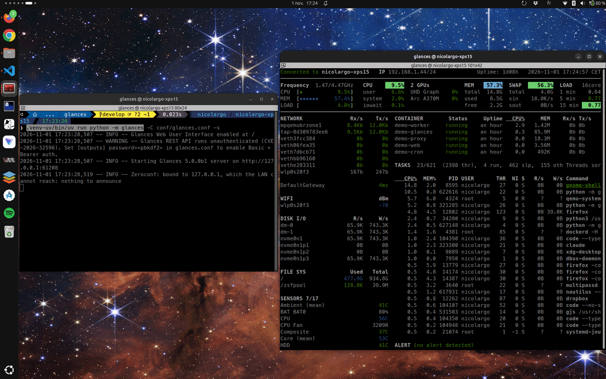
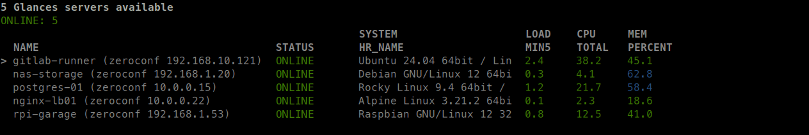
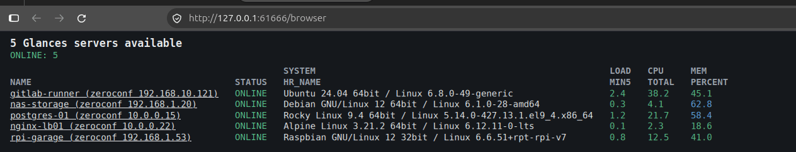
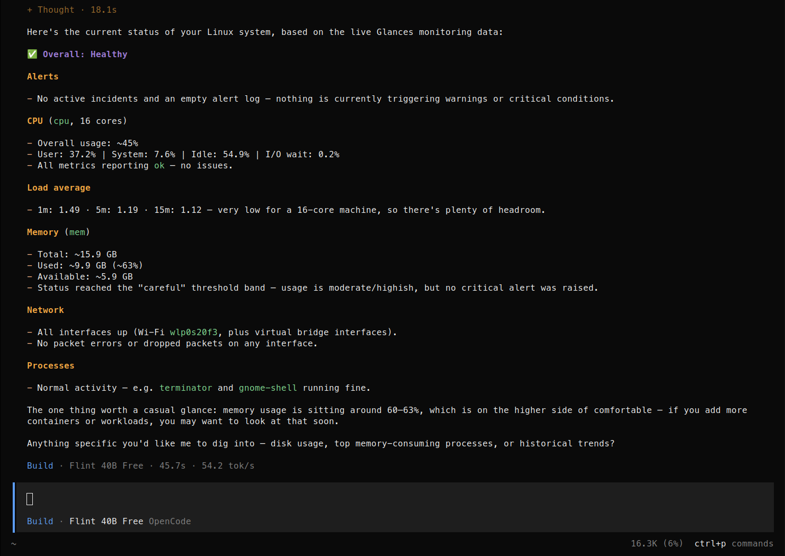
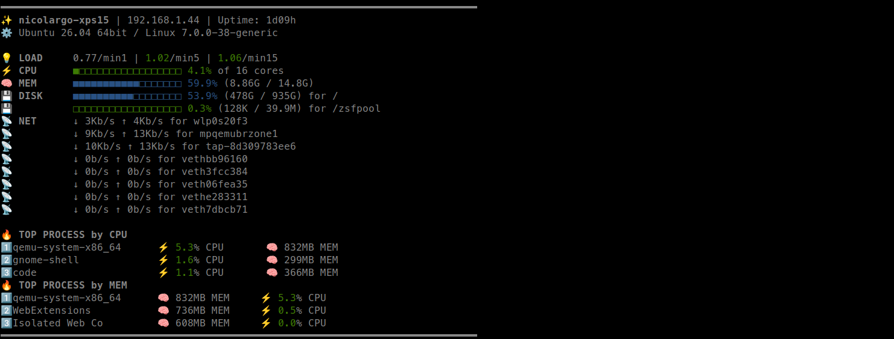
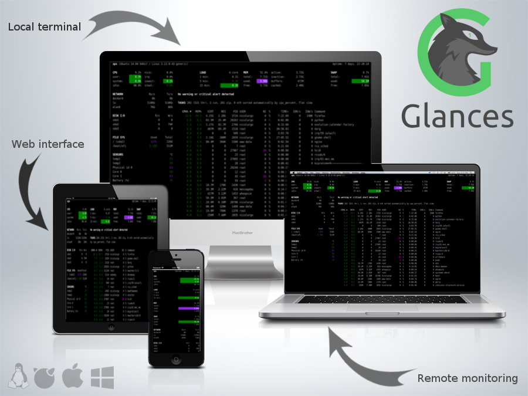

.. raw:: html

   

.. raw:: html

   <h1>Glances</h1>

An Eye on your System

|  |pypi| |test| |contributors| |codacity| |quality|
|  |starts| |docker| |pypistat| |sponsors|
|  |reddit|

.. |pypi| image:: https://img.shields.io/pypi/v/glances.svg
    :target: https://pypi.python.org/pypi/Glances

.. |starts| image:: https://img.shields.io/github/stars/nicolargo/glances.svg
    :target: https://github.com/nicolargo/glances/
    :alt: Github stars

.. |docker| image:: https://img.shields.io/docker/pulls/nicolargo/glances
    :target: https://hub.docker.com/r/nicolargo/glances/
    :alt: Docker pull

.. |pypistat| image:: https://pepy.tech/badge/glances/month
    :target: https://clickpy.clickhouse.com/dashboard/glances
    :alt: Pypi downloads

.. |test| image:: https://github.com/nicolargo/glances/actions/workflows/ci.yml/badge.svg?branch=develop
    :target: https://github.com/nicolargo/glances/actions
    :alt: Linux tests (GitHub Actions)

.. |contributors| image:: https://img.shields.io/github/contributors/nicolargo/glances
    :target: https://github.com/nicolargo/glances/issues?q=is%3Aissue+is%3Aopen+label%3A%22needs+contributor%22
    :alt: Contributors

.. |codacity| image:: https://app.codacy.com/project/badge/Grade/40708882575f4cb3943565889de2ed6e
    :target: https://app.codacy.com/gh/nicolargo/glances/dashboard?utm_source=gh&utm_medium=referral&utm_content=&utm_campaign=Badge_grade
    :alt: Codacity

.. |quality| image:: https://scrutinizer-ci.com/g/nicolargo/glances/badges/quality-score.png?b=develop
    :target: https://scrutinizer-ci.com/g/nicolargo/glances/?branch=develop
    :alt: Code quality

.. |sponsors| image:: https://img.shields.io/github/sponsors/nicolargo
    :target: https://github.com/sponsors/nicolargo
    :alt: Sponsors

.. |twitter| image:: https://img.shields.io/badge/X-000000?style=for-the-badge&logo=x&logoColor=white
    :target: https://twitter.com/nicolargo
    :alt: @nicolargo

.. |reddit| image:: https://img.shields.io/badge/Reddit-FF4500?style=for-the-badge&logo=reddit&logoColor=white
    :target: https://www.reddit.com/r/glances/
    :alt: @reddit

.. raw:: html

   

.. important::

    **The current stable release is Glances 4.5.8**: see the `v4.5.8 <https://github.com/nicolargo/glances/tree/v4.5.8>`__ tag for its
    source code and documentation. ``pip install glances`` installs it.

    **This branch (develop) contains Glances 5.0.0, currently in beta.**
    The rest of this page describes Glances 5.

.. warning::

    **Try Glances 5 (beta)** — for testing only:

    - it is a **beta**: expect bugs, and **do not use it in production**;
    - the **API is broken compared to Glances 4**: the REST API moves from ``/api/4``
      to ``/api/5``, the Python API is new, and a Glances 5 client only talks to a
      Glances 5 server (no XML-RPC anymore);
    - configuration files from Glances 4 are read, but some options changed.

    Install the beta from TestPyPI in a dedicated virtual environment
    (dependencies still come from PyPI):

    .. code-block:: console

        python3 -m venv ~/.venv-glances5
        source ~/.venv-glances5/bin/activate
        pip install --pre --index-url https://test.pypi.org/simple/ \
            --extra-index-url https://pypi.org/simple/ 'glances[web]>=5.0.0b1'
        glances --version

    Or run the ``nicolargo/glances:dev`` Docker image (built from this branch).
    Please report what you find in the GitHub `issues <https://github.com/nicolargo/glances/issues>`__.

Summary 🌟
==========

**Glances** is an open-source, cross-platform system monitoring tool.
It shows in real time CPU, memory, load, disks, file systems, network, sensors
(temperatures, voltages, fans, battery), GPUs, NPUs and processes.
It also monitors containers (Docker, Podman, LXD) and virtual machines
(Multipass, libvirt). Everything is presented in an easy-to-read dashboard,
in the terminal or in a Web browser, and you choose what to display.

In client/server mode, remote monitoring could be done via terminal,
Web interface or RESTful API.
Stats can also be exported to files or external time/value databases, CSV or direct
output to STDOUT.

AI assistants (Claude, Cursor, …) can query Glances directly through the built-in
MCP server.

Glances is written in Python and uses libraries to grab information from
your system. It is based on an open architecture where developers can
add new plugins or exports modules. It can also be used as a Python library
in your own scripts and notebooks.

Usage 👋
========

Glances can be used in the following modes.

1. TUI (standalone mode)
------------------------

Monitor the local machine in your terminal:

.. code-block:: console

    $ glances

Press ``h`` in the interface to display the hotkeys.

2. WebUI (Web server mode)
--------------------------

Start the Web server (REST API and WebUI):

.. code-block:: console

    $ glances -s

(``-w`` is an alias of ``-s``) and enter the URL ``http://localhost:61208`` in your
favorite web browser.

The server listens on ``127.0.0.1`` by default. To reach it from another machine,
listen on all interfaces with ``-B 0.0.0.0`` (or ``bind_address`` in the ``[outputs]``
section of the configuration file) and enter the URL ``http://<ip>:61208``.

The same server exposes a HTTP/RESTful API under ``/api/5``, see the `RestfulApi`_
documentation. It is **not protected by default**, see `Advanced usage 🔧`_ to set a
password.

3. TUI client / server mode
---------------------------

Start a server on the machine to monitor:

.. code-block:: console

    server$ glances -s -B 0.0.0.0

and display it in the terminal of another machine:

.. code-block:: console

    client$ glances -c <server_ip>

The client reads the stats from the server REST API (use ``--password`` to be
prompted for the server password). A Glances 5 client only talks to a Glances 5 server.

4. TUI browser
--------------

List all Glances servers available on your network (Zeroconf) or defined in the
``[serverlist]`` section of the configuration file, then open one of them:

.. code-block:: console

    $ glances --browser

5. WebUI browser
----------------

The same servers list, served in a Web page at ``http://<ip>:61208/browser``:

.. code-block:: console

    $ glances -s --browser

6. MCP server
-------------

Start the Web server with the `MCP (Model Context Protocol)`_ server enabled:

.. code-block:: console

    $ glances -s --enable-mcp

The MCP endpoint is then available at ``http://<ip>:61208/mcp`` (Streamable HTTP)
and ``http://<ip>:61208/mcp/sse`` (SSE, for older clients); the startup log gives both.
Plug it into your AI assistant (here `opencode`_) and ask it for the state of the machine:

.. code-block:: console

    $ opencode mcp add glances --url http://localhost:61208/mcp

See the `McpApi`_ documentation for client configuration and usage.

7. Fetch mode
-------------

Get (and share) a quick look of a machine, then exit:

.. code-block:: console

    $ glances --fetch

The output can be customized with a Jinja template (``--fetch-template``),
see the `Fetch`_ documentation.

Advanced usage 🔧
=================

Display raw stats on stdout:

.. code-block:: console

    $ glances --stdout cpu.user,mem.used,load
    cpu.user: 30.7
    mem.used: 3278204928
    load: {'min1': 0.21, 'min5': 0.4, 'min15': 0.27, 'cpucore': 4}
    cpu.user: 3.4
    mem.used: 3275251712
    load: {'min1': 0.19, 'min5': 0.39, 'min15': 0.27, 'cpucore': 4}
    ...

or in a CSV format thanks to the stdout-csv option:

.. code-block:: console

    $ glances --stdout-csv now,cpu.user,mem.used,load
    now.iso,now.custom,cpu.user,mem.used,load.min1,load.min5,load.min15,load.cpucore
    2026-10-11T15:12:54+00:00,2026-10-11 15:12:54 UTC,7.3,5948149760,1.04,0.99,1.04,4
    2026-10-11T15:12:56+00:00,2026-10-11 15:12:56 UTC,5.4,5949136896,1.04,0.99,1.04,4
    ...

or in a JSON format thanks to the stdout-json option (one JSON object per refresh, attribute not supported in this mode):

.. code-block:: console

    $ glances --stdout-json cpu,mem
    {"cpu": {"user": 24.7, "system": 3.8, "idle": 71.4, "nice": 0.0, "iowait": 0.0, "irq": 0.0, "steal": 0.0, "guest": 0.0, "total": 29.0, "ctx_switches": 0, "interrupts": 0, "soft_interrupts": 0, "syscalls": 0, "cpucore": 4}, "mem": {"total": 7837949952, "available": 2919079936, "percent": 62.8, "used": 4918870016, "free": 2919079936, "active": 2841214976, "inactive": 3340550144, "buffers": 546799616, "cached": 3068141568, "shared": 788156416, "slab": 158588928}}
    ...

Export stats without any interface, thanks to the quiet mode:

.. code-block:: console

    $ glances -q --export csv --export-csv-file /tmp/glances.csv

Protect the Web server with a password: generate a password hash

.. code-block:: console

    $ glances --set-password

and paste the printed value into the ``password`` key of the ``[outputs]`` section of
your ``glances.conf`` file.

Serve the REST API without the WebUI, and browse its interactive documentation
(Swagger at ``/docs``, ReDoc at ``/redoc``):

.. code-block:: console

    $ glances -s --disable-webui --api-doc

Choose what is collected and displayed:

.. code-block:: console

    $ glances --modules-list                     # list plugins and exporters
    $ glances --disable-plugin sensors,wifi      # do not collect these plugins
    $ glances -t 5                               # refresh every 5 seconds
    $ glances -f 'python.*'                      # filter the process list

Use another configuration file with ``-C <path>``, or override any key with an
environment variable ``GLANCES_<SECTION>__<KEY>=<value>`` (handy in containers),
see the `Configuration`_ documentation.

Report a bug: ``glances --issue`` tests every plugin and prints a Markdown report
to paste into the GitHub issue.

If you do not want to remember all those options, @yottajunaid has created a simple
launcher_ for Linux.

Use Glances as a Python library 📚
==================================

Every Glances plugin is available from Python, as a read-only mapping:

.. code-block:: python

    >>> from glances import api
    >>> gl = api.GlancesAPI()
    >>> gl.cpu["total"]
    6.8
    >>> gl.auto_unit(gl.mem["used"])
    '9.45G'
    >>> gl.network.keys()
    ['wlp0s20f3', 'mpqemubrzone1', 'tap-8d309783ee6']
    >>> gl.network["wlp0s20f3"]["bytes_recv"]
    101.7532271038767
    >>> [p["name"] for p in gl.top_process(limit=3)]
    ['Isolated Web Co', 'terminator', 'claude']
    >>> gl.plugins()
    ['amps', 'containers', 'core', 'cpu', 'diskio', 'folders', 'fs', 'gpu', 'ip', ...]

By default the stats are collected **on demand**, when they are read. In a notebook
or a long-running tool, let Glances collect them **in the background**, so the
history and the alerts fill up between two reads:

.. code-block:: python

    >>> import time
    >>> with api.GlancesAPI(background=True, plugins=["cpu", "mem"]) as gl:
    ...     time.sleep(60)
    ...     gl.cpu.history(nb=30)
    ...     gl.alerts()

Each plugin view also gives its fields description (``.fields``), its thresholds
(``.limits``) and its alert levels (``.levels``). The API reads ``glances.conf``
as Glances does, but never runs the configured actions nor the exporters.

The Glances 5 Python API replaces the Glances 4 one. See the `PythonApi`_
documentation for the complete reference.

Documentation 📜
================

The complete documentation is on readthedocs_:

.. list-table::
   :header-rows: 1
   :widths: 30 70

   * - Topic
     - Content
   * - 🚀 `Quickstart`_
     - First steps, modes and hotkeys
   * - ⌨️ `Command reference`_
     - All the command line options
   * - ⚙️ `Configuration`_
     - The ``glances.conf`` file
   * - 📊 `Plugins`_
     - What every plugin shows, and how to tune it
   * - 🌐 `Exports`_
     - Gateways to other services
   * - 🔌 `RestfulApi`_ / `PythonApi`_ / `McpApi`_
     - The APIs
   * - 🐳 `Docker`_
     - Run Glances in a container
   * - ❓ `FAQ`_
     - Frequently asked questions

If you have any question (after RTFM! and the `FAQ`_), please post it on the official
Reddit `forum`_ or in GitHub `Discussions`_.

Gateway to other services 🌐
============================

Glances can export its stats to:

.. list-table::
   :widths: 25 75

   * - 📁 **Files**
     - |csv| |json| |graph|
   * - 📈 **Time series**
     - |influxdb| |prometheus| |timescaledb| |graphite| |opentsdb| |statsd| |riemann|
   * - 🗄️ **Databases**
     - |elasticsearch| |clickhouse| |duckdb| |mongodb| |cassandra| |couchdb|
   * - 📨 **Message brokers**
     - |kafka| |rabbitmq| |mqtt| |nats| |zeromq|
   * - 🔗 **HTTP**
     - |restful|

.. |csv| image:: https://img.shields.io/badge/CSV-217346?logo=files&logoColor=white
    :target: https://glances.readthedocs.io/en/develop/gw/csv.html
    :alt: CSV
.. |json| image:: https://img.shields.io/badge/JSON-000000?logo=json&logoColor=white
    :target: https://glances.readthedocs.io/en/develop/gw/json.html
    :alt: JSON
.. |graph| image:: https://img.shields.io/badge/Graph%20(SVG)-FFB13B?logo=svg&logoColor=white
    :target: https://glances.readthedocs.io/en/develop/gw/graph.html
    :alt: Graph
.. |influxdb| image:: https://img.shields.io/badge/InfluxDB%201%2F2%2F3-22ADF6?logo=influxdb&logoColor=white
    :target: https://glances.readthedocs.io/en/develop/gw/influxdb.html
    :alt: InfluxDB
.. |prometheus| image:: https://img.shields.io/badge/Prometheus-E6522C?logo=prometheus&logoColor=white
    :target: https://glances.readthedocs.io/en/develop/gw/prometheus.html
    :alt: Prometheus
.. |timescaledb| image:: https://img.shields.io/badge/PostgreSQL%2FTimescaleDB-4169E1?logo=postgresql&logoColor=white
    :target: https://glances.readthedocs.io/en/develop/gw/timescaledb.html
    :alt: PostgreSQL/TimescaleDB
.. |graphite| image:: https://img.shields.io/badge/Graphite-5A5A5A
    :target: https://glances.readthedocs.io/en/develop/gw/graphite.html
    :alt: Graphite
.. |opentsdb| image:: https://img.shields.io/badge/OpenTSDB-4B8BBE
    :target: https://glances.readthedocs.io/en/develop/gw/opentsdb.html
    :alt: OpenTSDB
.. |statsd| image:: https://img.shields.io/badge/StatsD-6E4A7E
    :target: https://glances.readthedocs.io/en/develop/gw/statsd.html
    :alt: StatsD
.. |riemann| image:: https://img.shields.io/badge/Riemann-C0392B
    :target: https://glances.readthedocs.io/en/develop/gw/riemann.html
    :alt: Riemann
.. |elasticsearch| image:: https://img.shields.io/badge/Elasticsearch-005571?logo=elasticsearch&logoColor=white
    :target: https://glances.readthedocs.io/en/develop/gw/elastic.html
    :alt: Elasticsearch
.. |clickhouse| image:: https://img.shields.io/badge/ClickHouse-FFCC01?logo=clickhouse&logoColor=black
    :target: https://glances.readthedocs.io/en/develop/gw/clickhouse.html
    :alt: ClickHouse
.. |duckdb| image:: https://img.shields.io/badge/DuckDB-FFF000?logo=duckdb&logoColor=black
    :target: https://glances.readthedocs.io/en/develop/gw/duckdb.html
    :alt: DuckDB
.. |mongodb| image:: https://img.shields.io/badge/MongoDB-47A248?logo=mongodb&logoColor=white
    :target: https://glances.readthedocs.io/en/develop/gw/mongodb.html
    :alt: MongoDB
.. |cassandra| image:: https://img.shields.io/badge/Cassandra-1287B1?logo=apachecassandra&logoColor=white
    :target: https://glances.readthedocs.io/en/develop/gw/cassandra.html
    :alt: Cassandra
.. |couchdb| image:: https://img.shields.io/badge/CouchDB-E42528?logo=apachecouchdb&logoColor=white
    :target: https://glances.readthedocs.io/en/develop/gw/couchdb.html
    :alt: CouchDB
.. |kafka| image:: https://img.shields.io/badge/Kafka-231F20?logo=apachekafka&logoColor=white
    :target: https://glances.readthedocs.io/en/develop/gw/kafka.html
    :alt: Kafka
.. |rabbitmq| image:: https://img.shields.io/badge/RabbitMQ%2FActiveMQ-FF6600?logo=rabbitmq&logoColor=white
    :target: https://glances.readthedocs.io/en/develop/gw/rabbitmq.html
    :alt: RabbitMQ/ActiveMQ
.. |mqtt| image:: https://img.shields.io/badge/MQTT-660066?logo=mqtt&logoColor=white
    :target: https://glances.readthedocs.io/en/develop/gw/mqtt.html
    :alt: MQTT
.. |nats| image:: https://img.shields.io/badge/NATS-27AAE1?logo=natsdotio&logoColor=white
    :target: https://glances.readthedocs.io/en/develop/gw/nats.html
    :alt: NATS
.. |zeromq| image:: https://img.shields.io/badge/ZeroMQ-DF0000?logo=zeromq&logoColor=white
    :target: https://glances.readthedocs.io/en/develop/gw/zeromq.html
    :alt: ZeroMQ
.. |restful| image:: https://img.shields.io/badge/RESTful%20endpoint-009688?logo=fastapi&logoColor=white
    :target: https://glances.readthedocs.io/en/develop/gw/restful.html
    :alt: RESTful

Installation 🚀
===============

The methods below install the **latest stable release** (Glances 4.5.8 today).
To test Glances 5, see the beta box at the top of this page.

PyPI: pip, pipx or uv
---------------------

Glances is on ``PyPI``. Install it in a virtual environment with ``pip``:

.. code-block:: console

    python3 -m venv ~/.venv
    source ~/.venv/bin/activate
    pip install 'glances[all]'

or, as an isolated application, with `pipx`_ or `Uv`_:

.. code-block:: console

    pipx install 'glances[all]'    # installed in ~/.local/bin
    uvx glances                     # install and run in one line

To upgrade: ``pip install --upgrade glances`` (or ``pipx upgrade glances``).

``pip install glances`` (without extra) installs a minimal Glances, without the Web
interface. Pick only the features you need between the brackets, for example
``pip install 'glances[web,containers]'``:

.. list-table::
   :header-rows: 1
   :widths: 20 80

   * - Extra
     - Feature
   * - ``all``
     - All the features below
   * - ``web``
     - Web server mode (WebUI and REST API)
   * - ``mcp``
     - MCP server (AI assistant integration)
   * - ``browser``
     - Servers autodiscovery for the browser modes
   * - ``containers``
     - Docker, Podman and LXD containers
   * - ``gpu``
     - NVIDIA GPU
   * - ``sensors``
     - Battery (Linux)
   * - ``raid`` / ``smart`` / ``wifi``
     - RAID, S.M.A.R.T. and Wifi plugins (Linux)
   * - ``cloud``
     - Cloud instance metadata
   * - ``action``
     - Mustache templating in the alert actions
   * - ``export`` / ``graph``
     - Export modules / SVG graph export

*Note*: `psutil`_, the main Glances dependency, is built from source when no wheel
is available for your platform. Python headers and a C compiler are then required
(``python3-dev`` and ``gcc`` on Debian/Ubuntu, ``python3-devel`` on Fedora/RHEL).

Docker: the cloudy way
----------------------

Glances Docker images are available. You can use it to monitor your
server and all your containers !

The following tags are available:

- *latest-full* for a full Alpine Glances image (latest release) with all dependencies
- *latest* for a basic Alpine Glances (latest release) version with minimal dependencies (FastAPI and Docker)
- *dev* for a basic Alpine Glances image (based on development branch) with all dependencies (Warning: may be instable)
- *ubuntu-latest-full* for a full Ubuntu Glances image (latest release) with all dependencies
- *ubuntu-latest* for a basic Ubuntu Glances (latest release) version with minimal dependencies (FastAPI and Docker)
- *ubuntu-dev* for a basic Ubuntu Glances image (based on development branch) with all dependencies (Warning: may be instable)
- *<version>* and *<version>-full* (for example *5.0.0b1-full*), and their *ubuntu-* variants, for a given release

A pre-release (beta or release candidate) is only published under its version tags: it never moves the *latest* tags.

Run last version of Glances container in *console mode*:

.. code-block:: console

    docker run --rm -e TZ="${TZ}" -v /var/run/docker.sock:/var/run/docker.sock:ro -v /run/user/1000/podman/podman.sock:/run/user/1000/podman/podman.sock:ro --pid host --network host -it nicolargo/glances:latest-full

By default, the /etc/glances/glances.conf file is used (based on docker-compose/glances.conf).
This file sets ``bind_address=0.0.0.0`` in the ``[outputs]`` section, so that the Web server mode
is reachable from outside the container. On a shared network, also set ``[outputs] password``
and ``webui_allowed_hosts`` (see the configuration documentation). Mounting the Docker socket
``:ro`` protects the file, not the Docker API: the container can still drive the daemon.

Additionally, if you want to use your own glances.conf file, you can
create your own Dockerfile:

.. code-block:: console

    FROM nicolargo/glances:latest
    COPY glances.conf /root/.config/glances/glances.conf
    CMD python -m glances -C /root/.config/glances/glances.conf $GLANCES_OPT

Alternatively, you can specify something along the same lines with
docker run options (notice the `GLANCES_OPT` environment
variable setting parameters for the glances startup command):

.. code-block:: console

    docker run -e TZ="${TZ}" -v $HOME/.config/glances/glances.conf:/glances.conf:ro -v /var/run/docker.sock:/var/run/docker.sock:ro -v /run/user/1000/podman/podman.sock:/run/user/1000/podman/podman.sock:ro --pid host -e GLANCES_OPT="-C /glances.conf" -it nicolargo/glances:latest-full

Where $HOME/.config/glances/glances.conf is a local directory containing your glances.conf file.

With ``-C``, only the given file is read: set ``bind_address=0.0.0.0`` in its ``[outputs]`` section
(or add ``-B 0.0.0.0`` to ``GLANCES_OPT``) to use the Web server mode.

Run the container in *Web server mode* (and MCP server):

.. code-block:: console

    docker run -d --restart="always" -p 61208:61208 -e TZ="${TZ}" -e GLANCES_OPT="-w --enable-mcp" -v /var/run/docker.sock:/var/run/docker.sock:ro -v /run/user/1000/podman/podman.sock:/run/user/1000/podman/podman.sock:ro --pid host nicolargo/glances:latest-full

For a full list of options, see the Glances `Docker`_ documentation page.

Docker compose: Yet Another Cloudy Way
--------------------------------------

It is also possible to use a simple Docker compose file to:

- run the Web (Rest API and WebUI) and the MCP server (see in ./docker-compose/docker-compose.yml):

.. code-block:: console

    mkdir -p ~/glances-compose
    cd ~/glances-compose
    wget https://raw.githubusercontent.com/nicolargo/glances/refs/heads/develop/docker-compose/docker-compose.yml
    wget https://raw.githubusercontent.com/nicolargo/glances/refs/heads/develop/docker-compose/glances.conf
    docker compose up

- or run the terminal client (TUI):

.. code-block:: console

    mkdir -p ~/glances-compose
    cd ~/glances-compose
    wget https://raw.githubusercontent.com/nicolargo/glances/refs/heads/develop/docker-compose/docker-compose-tui.yml
    wget https://raw.githubusercontent.com/nicolargo/glances/refs/heads/develop/docker-compose/glances.conf
    docker compose -f ./docker-compose-tui.yml run glances

Shell tab completion 🔍
=======================

Glances includes shell tab autocompletion thanks to the --print-completion option.

For example, on a Linux operating system with bash shell:

.. code-block:: console

    $ mkdir -p ${XDG_DATA_HOME:="$HOME/.local/share"}/bash-completion
    $ glances --print-completion bash > ${XDG_DATA_HOME:="$HOME/.local/share"}/bash-completion/glances
    $ source ${XDG_DATA_HOME:="$HOME/.local/share"}/bash-completion/glances

Following shells are supported: bash, zsh, tcsh, fish and powershell.

Requirements 🧩
===============

Glances 5 requires **Python 3.10 or higher** (tested up to Python 3.14) and runs on
Linux, macOS, FreeBSD and Windows.

Core dependencies (always installed):

- ``psutil`` (system stats, better with the latest version)
- ``requests`` (client mode, Ports and Cloud plugins, RESTful export module)
- ``jinja2`` (fetch mode and templating)
- ``shtab`` (shell autocompletion) [All but Windows]
- ``windows-curses`` (curses implementation) [Windows only]

Optional dependencies, by extra (see the ``[project.optional-dependencies]`` section
of ``pyproject.toml`` for the exact versions):

.. list-table::
   :header-rows: 1
   :widths: 20 80

   * - Extra
     - Dependencies
   * - ``web``
     - ``fastapi``, ``uvicorn``, ``starlette``, ``python-jose``, ``msgpack``
   * - ``mcp``
     - ``mcp``
   * - ``browser``
     - ``zeroconf``
   * - ``containers``
     - ``docker``, ``podman``, ``pylxd`` (and ``packaging``, ``python-dateutil``, ``six``)
   * - ``gpu``
     - ``nvidia-ml-py``
   * - ``sensors``
     - ``batinfo`` [Linux only]
   * - ``raid``
     - ``pymdstat`` [Linux only]
   * - ``smart``
     - ``pySMART`` [Linux only]
   * - ``wifi``
     - ``wifi`` [Linux only]
   * - ``cloud``
     - ``requests``
   * - ``action``
     - ``chevron``
   * - ``graph``
     - ``pygal``
   * - ``export``
     - ``bernhard``, ``clickhouse-connect``, ``elasticsearch``, ``graphitesender``,
       ``ibmcloudant``, ``influxdb``, ``influxdb-client``, ``influxdb3-python``,
       ``kafka-python``, ``nats-py``, ``paho-mqtt``, ``pika``, ``potsdb``,
       ``prometheus_client``, ``psycopg[binary]``, ``pymongo``, ``pyzmq``, ``statsd``,
       ``pycouchdb``

Note: the ``export`` extra installs the libraries of **all** the export modules. If you
only use one or a few exports, prefer to install only the library of the wanted export
(for example ``pip install glances influxdb-client`` for InfluxDB 2).

``duckdb`` (DuckDB export module) is not included in any extra, install it manually if needed.

How to contribute ? 🤝
======================

If you want to contribute to the Glances project, read this `wiki`_ page.

There is also a chat dedicated to the Glances developers:

.. image:: https://badges.gitter.im/Join%20Chat.svg
        :target: https://gitter.im/nicolargo/glances?utm_source=badge&utm_medium=badge&utm_campaign=pr-badge&utm_content=badge

Project sponsorship 🙌
======================

You can help me to achieve my goals of improving this open-source project
or just say "thank you" by:

- sponsor me using one-time or monthly tier Github sponsors_ page
- send me some pieces of bitcoin: 185KN9FCix3svJYp7JQM7hRMfSKyeaJR4X

Any and all contributions are greatly appreciated.

Authors and Contributors 🔥
===========================

Glances has been created by Nicolas Hennion (@nicolargo) <nicolas@nicolargo.com>

and developed by a wonderfull contributors_ community.

License 📜
==========

Glances is distributed under the LGPL version 3 license. See ``COPYING`` for more details.

.. raw:: html

   

.. raw:: html

   

.. _psutil: https://github.com/giampaolo/psutil
.. _pipx: https://pipx.pypa.io/
.. _readthedocs: https://glances.readthedocs.io/en/develop/
.. _forum: https://www.reddit.com/r/glances/
.. _wiki: https://github.com/nicolargo/glances/wiki/How-to-contribute-to-Glances-%3F
.. _sponsors: https://github.com/sponsors/nicolargo
.. _wishlist: https://www.amazon.fr/hz/wishlist/ls/BWAAQKWFR3FI?ref_=wl_share
.. _Uv: https://docs.astral.sh/uv/getting-started/installation/
.. _Docker: https://github.com/nicolargo/glances/blob/develop/docs/docker.rst
.. _Quickstart: https://glances.readthedocs.io/en/develop/quickstart.html
.. _`Command reference`: https://glances.readthedocs.io/en/develop/cmds.html
.. _Configuration: https://glances.readthedocs.io/en/develop/config.html
.. _Plugins: https://glances.readthedocs.io/en/develop/aoa/index.html
.. _Exports: https://glances.readthedocs.io/en/develop/gw/index.html
.. _Fetch: https://glances.readthedocs.io/en/develop/fetch.html
.. _PythonApi: https://glances.readthedocs.io/en/develop/api/python.html
.. _RestfulApi: https://glances.readthedocs.io/en/develop/api/restful.html
.. _McpApi: https://glances.readthedocs.io/en/develop/api/mcp.html
.. _`MCP (Model Context Protocol)`: https://modelcontextprotocol.io
.. _FAQ: https://github.com/nicolargo/glances/blob/develop/docs/faq.rst
.. _Discussions: https://github.com/nicolargo/glances/discussions
.. _contributors: https://github.com/nicolargo/glances/graphs/contributors
.. _launcher: https://github.com/yottajunaid/glances-launcher
.. _opencode: https://opencode.ai
