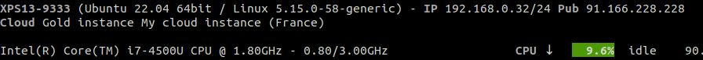

.. _cloud:

CLOUD
=====

This plugin displays information about the cloud provider if your host is running on OpenStack
or Amazon EC2.

The plugin use the standard OpenStack `metadata`_ service (or the EC2 instance metadata service)
to retrieve the information. The information is grabbed once and cached.

This plugin is disable by default, please use the --enable-plugin cloud option
to enable it.

.. _metadata: https://docs.openstack.org/nova/latest/user/metadata.html