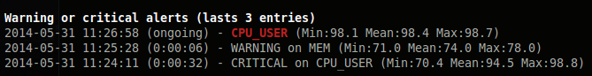

.. _events:

events
======

Events list (``ALERTS``) is displayed in the bottom of the right column of
the screen. When no alert has ever been raised, the block is reduced to a
single ``ALERT (no alert detected)`` line (``ALERT (initializing)`` during
the first refresh cycles).

Only ``WARNING`` and ``CRITICAL`` levels raise an alert: a ``CAREFUL`` level
colours the stat in its plugin but never creates an event.

The block title displays the number of ongoing and resolved alerts. Then
one line per alert (up to 10, ongoing alerts first) displays the following
information:

1. a glyph (``●`` for an ongoing alert, ``○`` for a resolved one)
2. start time (``HH:MM:SS`` for today, ``YY-MM-DD`` otherwise)
3. duration of the alert
4. target (plugin, item and stat in alert)
5. top processes during the alert (for CPU, memory, load... alerts)
6. level (``WARNING`` or ``CRITICAL``)

Columns are removed when the terminal is too narrow. Use the ``l`` key to
show/hide the events list.

The alerts engine is configured in the ``[alerts]`` section of the
Glances configuration file:

.. code-block:: ini

   [alerts]
   # Hold time, in seconds, before a level change is committed and logged
   # (avoid flapping alerts)
   min_duration_seconds=5.0
   # Maximum number of alert events kept in memory (served by /api/5/alert)
   history_size=200
   # Number of refresh cycles skipped, per plugin, at startup
   warmup_cycles=3
   # Maximum run time, in seconds, of an action command (0 = no timeout)
   action_timeout=0

The hold time can also be set per plugin, stat, level or item, in the
plugin section. The most specific key wins:

.. code-block:: ini

   [cpu]
   # Hold time for all the CPU stats
   min_duration_seconds=10
   # Hold time for the steal stat
   steal_min_duration_seconds=30
   # Hold time to enter the critical level of the steal stat
   steal_critical_min_duration_seconds=60

For a plugin with several items, ``<item>_<stat>_min_duration_seconds`` and
``<item>_<stat>_<level>_min_duration_seconds`` are also available (example:
``wlan0_bytes_recv_min_duration_seconds`` in the ``[network]`` section).

By default, all the alerts are logged in the events list. To keep a stat
coloured (and its actions running) but out of the events list, set
``<stat>_log=False`` (or ``log=False`` for the whole plugin) in the plugin
section:

.. code-block:: ini

   [cpu]
   steal_log=False

The events list is also available through the RESTful API:
``/api/5/alert`` (raw events) and ``/api/5/alert/incidents`` (one entry per
alert, as displayed in the user interface).
