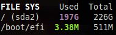

.. _fs:

File System
===========

Glances displays the used and total file system disk space. The unit is
adapted dynamically.

To display the free space instead of the used space, use the ``F`` key, the
``--fs-free-space`` command line option or the ``free_space=True`` key in the
``[fs]`` section of the configuration file.

Alerts are set for `user disk space usage <https://psutil.readthedocs.io/en/latest/index.html?highlight=disk%20usage#psutil.disk_usage>`_.

Legend (with the default configuration file):

===================== ============
User disk space usage Status
===================== ============
``<50%``              ``OK``
``>50%``              ``CAREFUL``
``>70%``              ``WARNING``
``>90%``              ``CRITICAL``
===================== ============

.. note::
    Limit values can be overwritten in the configuration file under
    the ``[fs]`` section (default values if not defined: 70/80/90).

Limits can also be defined per mount point with the
``<mount_point>_percent_<level>`` keys:

.. code-block:: ini

    [fs]
    careful=50
    warning=70
    critical=90
    /_percent_careful=40
    /_percent_warning=60
    /_percent_critical=80

There is no alert on read-only file systems (squashfs snaps, ISO...).

An alias can be defined for a mount point:

.. code-block:: ini

    [fs]
    alias=/:Root,/zfspool:ZFS

By default, the plugin only displays physical devices (hard disks, USB
keys). To allow other file system types, you have to enable them in the
configuration file. For example, if you want to allow the ``shm`` file
system:

.. code-block:: ini

    [fs]
    allow=shm

With the above configuration key, it is also possible to monitor NFS
mount points (allow=nfs). Be aware that this can slow down the
performance of the plugin if the NFS server is not reachable. In this
case, the plugin will wait for a 2 seconds timeout.

Also, you can hide mount points using regular expressions.

To hide all mount points starting with /boot and /snap:

.. code-block:: ini

    [fs]
    hide=/boot.*,/snap.*

Filtering are also applied on device name and alias.

It is also possible to configure a white list of devices to display.
Example to only show /dev/sdb mount points:

.. code-block:: ini

     [fs]
     show=/dev/sdb.*

Filtering is based on regular expression. Please be sure that your regular
expression works as expected. You can use an online tool like `regex101`_ in
order to test your regular expression.

.. _regex101: https://regex101.com/