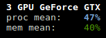
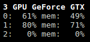

.. _gpu:

GPU
===

For the moment, following GPU are supported:
- NVidia (thanks to the `nvidia-ml-py`_ library)
- NVidia Jetson / Tegra integrated GPU (NVML reports the device but not its
  telemetry, so usage and temperature are read from Tegra sysfs)
- AMD (only on Linux Operating system with kernel 5.14 or higher)
- Intel (only on Linux Operating system)
- ARM (only on Linux Operating system with kernel 6.0 or higher;
  drivers: msm/Adreno, Panfrost, Panthor, v3d, Lima, Etnaviv)

The GPU stats are shown as a percentage of value and for the configured
refresh time. It displays:

- GPU usage (NVidia, AMD and ARM) or frequency (Intel)
- memory consumption (NVidia, AMD, and ARM when exposed by fdinfo)
- temperature (if available)

.. note::
    For ``panthor`` and ``panfrost``, per-engine sampling
    (``drm-engine-*`` and ``drm-cycles-*`` fdinfo counters) is disabled
    by default to save power. Enable it via sysfs:

    .. code-block:: bash

        echo 1 > /sys/bus/platform/drivers/panthor/*.gpu/profiling
        echo 1 > /sys/bus/platform/drivers/panfrost/*.gpu/profiling

If you have more than one GPU, the per-GPU view (one line per GPU) is
displayed by default. Click on the ``6`` short key to switch between the
per-GPU view and the mean view (above):

.. note::
    You can also start Glances with the ``--meangpu`` option to display
    the mean view by default.

You can change the threshold limits in the configuration file:

.. code-block:: ini

    [gpu]
    # Default processor values if not defined: 70/80/90
    proc_careful=50
    proc_warning=70
    proc_critical=90
    # Default memory values if not defined: 70/80/90
    mem_careful=50
    mem_warning=70
    mem_critical=90
    # Temperature (default values if not defined: 60/70/80)
    temperature_careful=60
    temperature_warning=70
    temperature_critical=80

Thresholds can also be defined for a specific GPU with the
``<gpu_id>_<stat>_<level>`` keys (example: ``nvidia0_temperature_critical=85``).

Legend (with the default configuration file):

============== ============
GPU (PROC/MEM) Status
============== ============
``<50%``       ``OK``
``>50%``       ``CAREFUL``
``>70%``       ``WARNING``
``>90%``       ``CRITICAL``
============== ============

.. _nvidia-ml-py: https://pypi.org/project/nvidia-ml-py/
