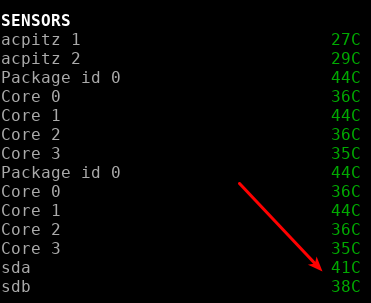

.. _hddtemp:

HDD temperature sensor
======================

*Availability: Linux*

This plugin will add HDD temperature to the sensors plugin.

On your Linux system, you will need to have:
- hddtemp package installed
- hddtemp service up and running (check it with systemctl status hddtemp)
- the TCP port 7634  opened on your local firewall (if it is enabled on your system)

For example on a CentOS/Redhat Linux operating system, you have to:

    $ sudo yum install hddtemp

    $ sudo systemctl enable hddtemp

    $ sudo systemctl enable hddtemp

Test it in the console:

    $ hddtemp

    /dev/sda: TOSHIBA MQ01ACF050: 41°C

    /dev/sdb: ST1000LM044 HN-M101SAD: 38°C

It should appears in the sensors plugin.

By default, Glances connects to the hddtemp daemon on ``127.0.0.1:7634``.
The connection can be configured (or the feature disabled) in the
``[hddtemp]`` section of the configuration file:

.. code-block:: ini

    [hddtemp]
    disable=False
    # Define hddtemp server IP and port (default is 127.0.0.1 and 7634 (TCP))
    host=127.0.0.1
    port=7634

If the daemon can not be reached, Glances stops polling it until the next
restart.

.. note::
    Limit values (``temperature_hdd_careful``, ``temperature_hdd_warning``
    and ``temperature_hdd_critical``) and sensors alias names can be
    defined in the configuration file under the ``[sensors]`` section.
