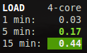
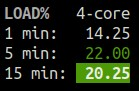

.. _load:

Load
====

*Availability: Unix and Windows with a PsUtil version >= 5.6.2*

On the *No Sheep* blog, Zachary Tirrell defines the `load average`_
on GNU/Linux operating system:

    "In short it is the average sum of the number of processes
    waiting in the run-queue plus the number currently executing
    over 1, 5, and 15 minutes time periods."

Be aware that Load on Linux, BSD and Windows are different things, high
`load on BSD`_ does not means high CPU load. The Windows load is emulated
by the PsUtil lib (see `load on Windows`_)

Load stats description:

- **min1**: Average sum of the number of processes waiting in the run-queue
  plus the number currently executing over 1 minute.
- **min5**: Average sum of the number of processes waiting in the run-queue
  plus the number currently executing over 5 minutes.
- **min15**: Average sum of the number of processes waiting in the run-queue
  plus the number currently executing over 15 minutes.

Glances gets the number of CPU core (displayed on the first line) to adapt
the alerts. Alerts on load average are set on 5 and 15 minutes time
periods (the 15 minutes one is highlighted with a colored background).
There is no alert on the 1 minute load average.

Thresholds are computed by dividing the 5 and 15 minutes average load per
CPU(s) number. For example, if you have 4 CPUs and the 5 minutes load is
1.0, then the warning threshold will be set to 2.8 (0.7 * 4 * 1.0).

If the ``0`` key is pressed (or the ``-0`` command line option is used),
the value is divided by logical core number and multiple by 100 to have
load as a percentage.

Legend:

============= ============
Load avg      Status
============= ============
``<0.7*core`` ``OK``
``>0.7*core`` ``CAREFUL``
``>1*core``   ``WARNING``
``>5*core``   ``CRITICAL``
============= ============

.. note::
    Limit values can be overwritten in the configuration file under
    the ``[load]`` section.

.. _load average: http://nosheep.net/story/defining-unix-load-average/
.. _load on BSD: http://undeadly.org/cgi?action=article&sid=20090715034920
.. _load on Windows: https://psutil.readthedocs.io/en/latest/#psutil.getloadavg
