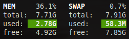
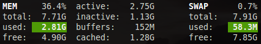

.. _memory:

Memory
======

Glances uses two columns: one for the ``RAM`` and one for the ``SWAP``.

If enough space is available, Glances displays extended information for
the ``RAM``:

Stats description:

- **percent**: the percentage usage calculated as (total-available)/total*100.
- **total**: total physical memory available.
- **used**: memory used, calculated differently depending on the platform and
  designed for informational purposes only.
  It's compute as following:
  used memory = total - free (with free = available + buffers + cached)
- **free**: memory not being used at all (zeroed) that is readily available;
  note that this doesn’t reflect the actual memory available (use ‘available’
  instead).
- **active**: (UNIX): memory currently in use or very recently used, and so it
  is in RAM.
- **inactive**: (UNIX): memory that is marked as not used.
- **buffers**: (Linux, BSD): cache for things like file system metadata.
- **cached**: (Linux, BSD): cache for various things (including ZFS cache).

Additional stats available in through the API:

- **available**: the actual amount of available memory that can be given
  instantly to processes that request more memory in bytes; this is calculated
  by summing different memory values depending on the platform (e.g. free +
  buffers + cached on Linux) and it is supposed to be used to monitor actual
  memory usage in a cross platform fashion.
- **wired**: (BSD, macOS): memory that is marked to always stay in RAM. It is
  never moved to disk.
- **shared**: (BSD): memory that may be simultaneously accessed by multiple
  processes.
- **slab**: (Linux): in-kernel data structures cache.

It is possible to display the available memory instead of the used memory
by setting the ``available`` option to ``True`` in the configuration file
under the ``[mem]`` section.

The ``SWAP`` column displays the swap usage, the total swap size and the
swap in (``sin``) and swap out (``sout``) rates (bytes per second).

By default, alerts are only set for used memory and used swap.

Legend:

======== ======== ============
RAM      Swap     Status
======== ======== ============
``<50%`` ``<60%`` ``OK``
``>50%`` ``>60%`` ``CAREFUL``
``>70%`` ``>80%`` ``WARNING``
``>90%`` ``>95%`` ``CRITICAL``
======== ======== ============

.. note::
    Limit values can be overwritten in the configuration file under
    the ``[mem]`` and/or ``[memswap]`` sections.

Swap thresholds are set with the ``percent_careful``, ``percent_warning``
and ``percent_critical`` keys of the ``[memswap]`` section. Alerts on the
swap in/out rates are disabled by default; they can be enabled with the
``sin_careful`` (``sin_warning``, ``sin_critical``) and ``sout_careful``
(``sout_warning``, ``sout_critical``) keys, in bytes per second:

.. code-block:: ini

    [memswap]
    percent_careful=60
    percent_warning=80
    percent_critical=95
    sin_careful=40960
    sin_warning=409600
    sin_critical=819200
