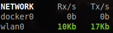

.. _network:

Network
=======

Glances displays the network interface bit rate. The unit is adapted
dynamically (bit/s, kbit/s, Mbit/s, etc).

In the terminal interface, use the ``b`` key to switch between bit/s and
byte/s, the ``U`` key to switch between rate and cumulative values and the
``T`` key to display the sum of received and sent traffic.

If the interface speed is detected (not on all systems), the defaults
thresholds are applied (70% for careful, 80% warning and 90% critical).
It is possible to define these thresholds from the configuration file,
globally or per interface, with the ``bytes_recv_<level>`` and
``bytes_sent_<level>`` keys. Thresholds are expressed as a **ratio of the
interface speed, between 0 and 1** (0.7 means 70%). Interfaces without a
detected speed (loopback, most virtual interfaces...) have no bit rate
alert.

Glances also raises alerts on receive/send errors (``errors_in_<level>``
and ``errors_out_<level>`` keys, in errors per second, default values
1/5/20).

Additionally, you can define:

- a list of network interfaces to hide
- automatically hide interfaces not up
- automatically hide interfaces without IP address
- per-interface limit values
- aliases for interface name (use \ to espace special characters)

The configuration should be done in the ``[network]`` section of the
Glances configuration file.

For example, if you want to hide the loopback interface (lo) and all the
virtual docker interface (docker0, docker1, ...):

.. code-block:: ini

    [network]
    # Default bitrate thresholds as a ratio [0-1] of the network interface speed
    # Default values if not defined: 0.7/0.8/0.9
    bytes_recv_careful=0.7
    bytes_recv_warning=0.8
    bytes_recv_critical=0.9
    bytes_sent_careful=0.7
    bytes_sent_warning=0.8
    bytes_sent_critical=0.9
    # Define the list of hidden network interfaces (comma-separated regexp)
    hide=docker.*,lo
    # Define the list of network interfaces to show (comma-separated regexp)
    #show=eth0,eth1
    # Automatically hide interface not up (default is False)
    hide_no_up=True
    # Automatically hide interface with no IP address (default is False)
    hide_no_ip=True
    # Set hide_zero to True to automatically hide interface with no traffic
    hide_zero=False
    # WLAN 0 alias
    alias=wlan0:Wireless IF
    # It is possible to overwrite the bitrate thresholds per interface
    # WLAN 0 limits (ratio [0-1] of the interface speed)
    wlan0_bytes_recv_careful=0.5
    wlan0_bytes_recv_warning=0.6
    wlan0_bytes_recv_critical=0.7
    wlan0_bytes_recv_log=True
    wlan0_bytes_sent_careful=0.5
    wlan0_bytes_sent_warning=0.6
    wlan0_bytes_sent_critical=0.7
    wlan0_bytes_sent_log=True

Filtering is based on regular expression. Please be sure that your regular
expression works as expected. You can use an online tool like `regex101`_ in
order to test your regular expression.

You also can automatically hide interface with no traffic using the
``hide_zero`` configuration key. The optional ``hide_threshold_bytes`` option
can also be used to set a threshold higher than zero.

.. code-block:: ini

    [network]
    hide_zero=True
    hide_threshold_bytes=0

.. _regex101: https://regex101.com/
