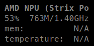

.. _npu:

NPU
===

Note: this plugin is disable by default (set ``disable=False`` in the ``[npu]``
section of the glances.conf file or use the ``--enable-plugin npu`` option to
enable it). Use the ``7`` key to show/hide it in the terminal interface.

For the moment, only following NPU are supported on modern Linux Kernel:
- AMD: frequency
- INTEL: frequency, temperature
- ROCKSHIP: load, frequency

.. code-block:: ini

    [npu]
    disable=False
    # Default NPU load thresholds in %
    load_careful=50
    load_warning=70
    load_critical=90
    # Default NPU frequency thresholds in %
    freq_careful=50
    freq_warning=70
    freq_critical=90
    # Default NPU memory thresholds in %
    mem_careful=50
    mem_warning=70
    mem_critical=90
    # Default NPU temperature thresholds in degrees Celsius
    temperature_careful=60
    temperature_warning=70
    temperature_critical=80
