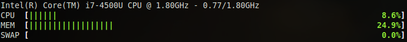
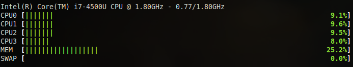

.. _quicklook:

Quick Look
==========

The ``quicklook`` plugin is only displayed on wide screen and proposes a
bar view for cpu, memory, swap, load and gpu (this list is configurable).

In the terminal interface, click on ``3`` to enable/disable it.

If the per CPU mode is on (by clicking the ``1`` key):

In the terminal interface, click on ``4`` to display the quicklook plugin
in full width (the other plugins of the top row are hidden).

.. note::
    Limit values can be overwritten in the configuration file under
    the ``[quicklook]`` section.

You can also configure the stats list and the bat character used in the
user interface.

.. code-block:: ini

    [quicklook]
    # Stats list (default is cpu,mem,load)
    # Available stats are: cpu,mem,load,swap,gpu_proc,gpu_mem
    list=cpu,mem,load
    # Graphical percentage char used in the terminal user interface (default is |)
    bar_char=|
