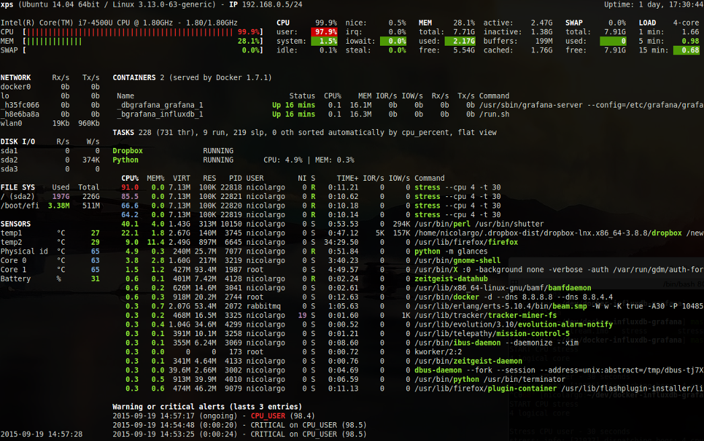
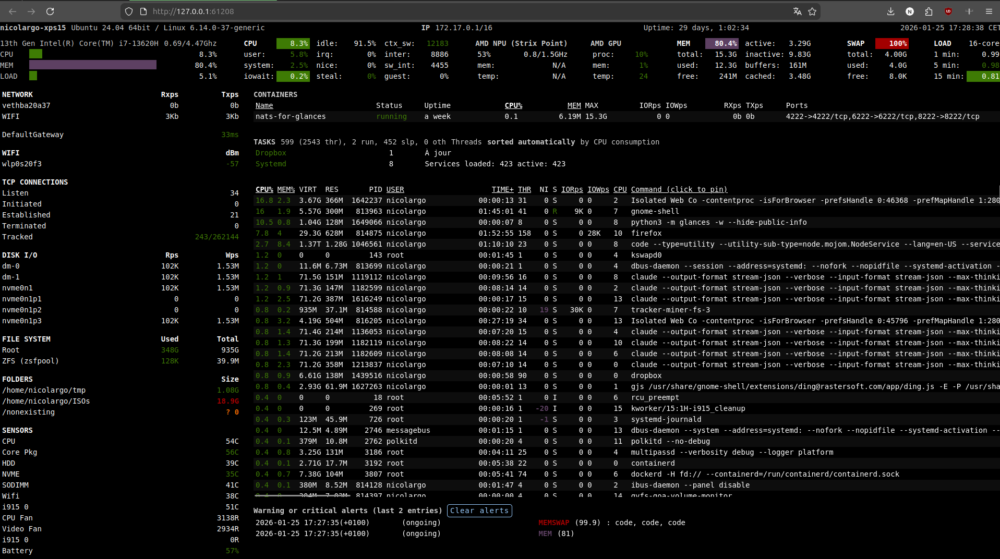
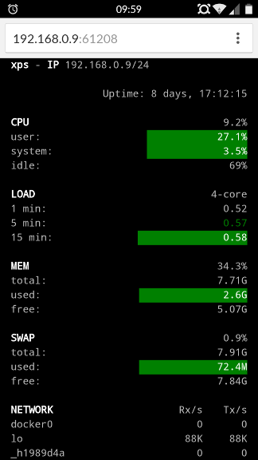

.. _quickstart:

Quickstart
==========

This page gives a good introduction to how to get started with Glances.
Glances offers multiple modes:

- Standalone (TUI)
- Server (REST API and Web UI) / Client
- Fetch

Standalone Mode
---------------

If you want to monitor your local machine, open a console/terminal
and simply run:

.. code-block:: console

    $ glances

Glances should start (press 'q' or 'ESC' to exit):

It is also possible to display RAW (Python) stats directly to stdout using:

.. code-block:: console

    $ glances --stdout cpu.user,mem.used,load,network.wlp2s0.bytes_recv
    cpu.user: 25.0
    mem.used: 954605568
    load: {'min1': 2.09, 'min5': 1.01, 'min15': 0.72, 'cpucore': 4}
    network.wlp2s0.bytes_recv: 13479
    cpu.user: 42.6
    mem.used: 1033232384
    load: {'min1': 2.24, 'min5': 1.06, 'min15': 0.74, 'cpucore': 4}
    network.wlp2s0.bytes_recv: 12868
    ...

or in a CSV format thanks to the stdout-csv option (key not supported in this mode):

.. code-block:: console

    $ glances --stdout-csv now,cpu.user,mem.used,load
    now.iso,now.custom,cpu.user,mem.used,load.min1,load.min5,load.min15,load.cpucore
    2026-10-11T15:12:05+00:00,2026-10-11 15:12:05 UTC,47.4,1062043648,2.22,1.08,0.74,4
    ...

or as a JSON format thanks to the stdout-json option (attribute not supported in this mode):

.. code-block:: console

    $ glances --stdout-json cpu,load
    {"cpu": {"user": 50.0, "system": 6.3, "idle": 43.7, "nice": 0.0, "iowait": 0.0, "irq": 0.0, "steal": 0.0, "guest": 0.0, "total": 56.3, "cpucore": 4, ...}, "load": {"min1": 2.22, "min5": 1.08, "min15": 0.74, "cpucore": 4}}
    ...

Note: ``--stdout`` displays one line per stat per refresh, ``--stdout-json``
one JSON object per refresh and ``--stdout-csv`` one line per refresh.

Use ``--stop-after <n>`` to stop after n refreshes.

Server Mode (REST API and Web UI)
---------------------------------

If you want to remotely monitor a machine called ``server``, from any
device with a web browser, just run the server with the ``-s`` option
(``-w`` is the same mode, kept from Glances v4):

.. code-block:: console

    server$ glances -s -B 0.0.0.0

then, on the client, enter the following URL in your favorite web browser:

::

    http://@server:61208

where ``@server`` is the IP address or hostname of the server.

The server runs headless (no TUI). It serves the RESTful API on ``/api/5``
(see :ref:`api_restful`) and the Web UI on ``/``. Use ``--disable-webui``
to only serve the API.

The default bind address is ``127.0.0.1``: the server only answers on the
local machine. Use ``-B ADDRESS`` (or ``bind_address`` in the ``[outputs]``
section of the configuration file) to listen on another interface,
``0.0.0.0`` for all the IPv4 interfaces. The default TCP port is ``61208``,
it can be changed with ``-p PORT`` (or ``port`` in ``[outputs]``).

To change the refresh rate of the page, add the period in seconds
to the URL. For example, to refresh the page every ``10``
seconds:

::

    http://@server:61208/?refresh=10

The Glances web interface follows responsive web design principles.

Here's a screenshot from Chrome on Android:

Security — DNS rebinding protection
^^^^^^^^^^^^^^^^^^^^^^^^^^^^^^^^^^^

A server bound to a loopback address (the default ``127.0.0.1``) only
accepts requests whose HTTP ``Host`` header is ``localhost``, ``127.0.0.1``
or ``[::1]``. A server bound to another address applies no ``Host``
filtering and logs a warning at startup.

**Set the accepted Host values** with ``webui_allowed_hosts`` in the
``[outputs]`` section of ``glances.conf``, for example behind a reverse
proxy that forwards its own ``Host`` or for any deployment on a
non-loopback interface:

.. code-block:: ini

    [outputs]
    webui_allowed_hosts=localhost,127.0.0.1,myserver.example.com

Requests whose ``Host`` header does not match any of the listed patterns
are rejected with ``400 Bad Request``. Wildcards are supported, for example
``*.example.com``.

Client Mode
-----------

You can also display the stats of a remote Glances server in your terminal.
Run the server as described above (``glances -s -B 0.0.0.0``) and, on the
client:

.. code-block:: console

    client$ glances -c @server

where ``@server`` is the IP address or hostname of the server. It is also
possible to give ``@server:port`` or an ``http(s)://`` URL (for a server
behind a TLS reverse proxy).

In client mode, you can set the TCP port of the server with ``-p PORT``.

The client only speaks to a Glances v5 server (REST API ``/api/5``); the
Glances v4 XML-RPC server is not supported anymore.

In client/server mode, limits are set by the server side.

Central Glances Browser
^^^^^^^^^^^^^^^^^^^^^^^

.. image:: _static/browser.png

Glances can centralize available Glances servers using the ``--browser``
option. The server list can be statically defined via the configuration
file (section ``[serverlist]``).

Example:

.. code-block:: ini

    [serverlist]
    # Define columns (comma separated list of <plugin>:<field>:(<key>)) to grab/display
    # Default is: system:hr_name,load:min5,cpu:total,mem:percent
    # You can also add stats with key, like sensors:value:Ambient
    columns=system:hr_name,load:min5,cpu:total,mem:percent,memswap:percent
    # Define the static servers list (the port defaults to 61208)
    server_1_name=xps
    server_1_alias=xps
    server_1_port=61208
    server_2_name=win
    server_2_port=61235
    # The name can also be an http(s):// URL
    server_3_name=https://glances.example.com

Glances can also detect and display all Glances v5 servers available on
your network via the ``zeroconf`` protocol (``browser`` extra needed):

To start the TUI Central Glances Browser, use the following option:

.. code-block:: console

    client$ glances --browser

When the list is displayed, you can navigate through the Glances servers with
up/down keys and open one with ENTER. It is also possible to sort the server using:

- '1' is normal (do not sort)
- '2' is using sorting by status (UNKNOWN > OFFLINE > PROTECTED > UNSUPPORTED > ONLINE)
- '3' is using sorting by status in reverse order (ONLINE > UNSUPPORTED > PROTECTED > OFFLINE > UNKNOWN)

``UNSUPPORTED`` means that something answers on the port, but not the Glances
v5 API (a Glances v4 server, for example).

A server discovered on the network is listed as ``<name> (zeroconf <address>)``
and opened at that address: anyone on the network can announce under any name,
so check the address before typing a password (it is sent over clear HTTP).
An announcement that uses the name or alias of a ``[serverlist]`` server is
ignored.

To start the WebUI Central Glances Browser, use the following option:

.. code-block:: console

    client$ glances --browser -s

Open the URL (/browser) and click on the server to display stats. The
servers list is also available on the ``/api/5/serverslist`` endpoint.

.. note::

    Use ``--disable-autodiscover`` to disable the auto-discovery mode.

IPv6
^^^^

Glances is ``IPv6`` compatible. Just use the ``-B ::`` option to bind to
all IPv6 addresses.

How do you protect your server with a login/password ?
------------------------------------------------------

Generate a password hash with the ``--set-password`` option:

.. code-block:: console

    $ glances --set-password
    Password:
    Confirm:

    Paste this value into [outputs] password of your glances.conf:

    <salt>$<hash>

and paste it in the ``[outputs]`` section of the Glances configuration file
(``~/.config/glances/glances.conf`` on GNU Linux operating system).
By default, the login is ``glances`` but you can change it with the
``username`` key:

.. code-block:: ini

    [outputs]
    password=<salt>$<hash>
    # Optional, default is glances
    #username=glances

The REST API and the Web UI then require this login/password (HTTP Basic
authentication or a JWT bearer token from ``/api/5/token``).

On the client side, use ``-u <username>`` to set the login and
``--password`` to be prompted for the server's password. It is also
possible to set the client passwords in the Glances configuration file:

.. code-block:: ini

    [passwords]
    # Define the passwords list
    # Syntax: host=password
    # Where: host is the hostname
    #        password is the clear password
    # Additionally (and optionally) a default password could be defined
    localhost=mylocalhostpassword
    default=mydefaultpassword

Fetch mode
----------

It is also possible to get and share a quick look of a machine using the
``fetch`` mode. In this mode, current stats are display on the console in
a fancy way.

.. code-block:: console

    $ glances --fetch

Results look like this:

.. image:: _static/screenshot-fetch.png

It is also possible to use a custom template with the ``--fetch --fetch-template </path/to/template.jinja>`` options.

Have a look to the :ref:`fetch documentation page<fetch>` to learn how to create your own template.
